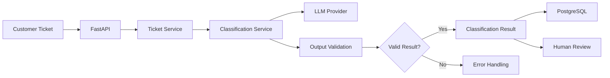
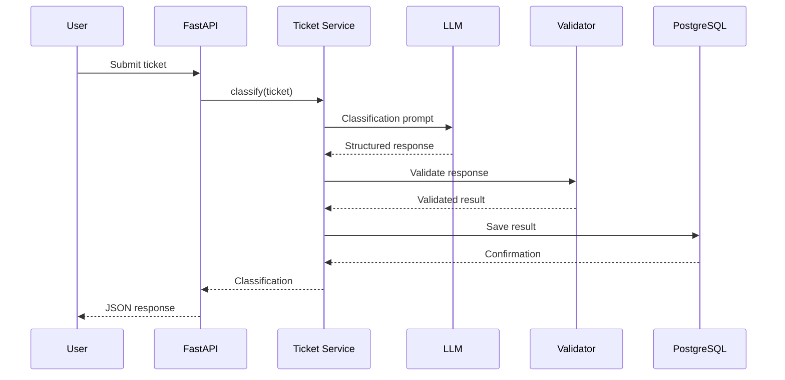
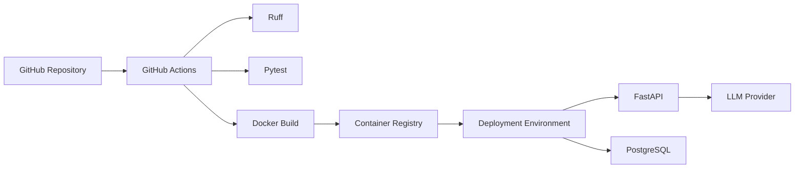

# Project A1 — AI Ticket Classification Agent

**Track:** AI Engineer  
**Project:** 01 of 05

## Objective

Build an AI-powered ticket classification system that understands customer support requests, extracts relevant information, determines ticket priority, and returns structured results.

You will develop this project from a simple Python application into a production-ready AI service.

## 1. Project Scope

### Business Problem

Customer support teams receive thousands of tickets. Manually reading, categorizing, prioritizing and routing each ticket takes time and creates inconsistent results.

### Solution

Build an AI Ticket Classification Agent that:

1. Receives a customer support ticket.
2. Understands the customer's intent.
3. Classifies the ticket into a category.
4. Extracts relevant entities.
5. Determines priority.
6. Identifies whether additional information or a tool lookup is required.
7. Returns structured JSON.
8. Allows a human to review the classification.

### Example Input

```json
{
  "ticket_id": "TICKET-001",
  "message": "My order #4821 has not arrived."
}
```

### Expected Output

```json
{
  "ticket_id": "TICKET-001",
  "category": "order_status",
  "priority": "medium",
  "order_id": "4821",
  "sentiment": "negative",
  "needs_order_lookup": true,
  "confidence": 0.95,
  "requires_human_review": false
}
```

The confidence value above is illustrative; the application must learn to calibrate and evaluate its confidence rather than simply trust an LLM-generated number.

## 2. Technology Stack

| Area | Technology |
|---|---|
| Language | Python |
| Package management | uv |
| Data validation | Pydantic |
| API | FastAPI |
| LLM | OpenAI API |
| Database | PostgreSQL |
| Testing | pytest |
| Code quality | Ruff |
| Logging | Python logging |
| Containerization | Docker |
| CI/CD | GitHub Actions |

Start with a modular Python application. Introduce an LLM after establishing the domain model and a deterministic baseline.

## 3. Project Lifecycle — 9 Stages

The following is the complete project plan, including the work, deliverables and learning objectives for each stage.

### Stage 1 — Discovery

**Goal:** Understand the business problem before writing code.

| Required work | Details |
|---|---|
| Business problem | Manual ticket classification is slow and inconsistent. |
| Stakeholders | Customer support agents, support managers, product owner, engineering team. |
| Business requirements | Automatically classify tickets and extract relevant information. |
| Functional requirements | Categorization, priority detection, entity extraction, sentiment detection. |
| Non-functional requirements | Accuracy, reliability, low latency, scalability and security. |
| Assumptions | Tickets arrive as text; classification is advisory, not autonomous. |
| Constraints | LLM cost, API availability, incorrect classifications and sensitive customer data. |
| Success metrics | Classification accuracy, extraction accuracy, latency, cost per ticket and human correction rate. |

Define initial categories:

- `order_status`
- `refund`
- `cancellation`
- `payment`
- `technical_issue`
- `account_access`
- `product_information`
- `other`

#### Deliverables

```text
01-discovery/
├── README.md
├── discovery-brief.md
├── stakeholder-interviews.md
├── business-requirements.md
├── functional-requirements.md
├── non-functional-requirements.md
├── assumptions-and-constraints.md
└── success-metrics.md
```

#### Learning Objectives

- Requirements engineering.
- Stakeholder analysis.
- Functional vs non-functional requirements.
- Business KPIs.
- Scope definition.

#### Completion Criteria

You can explain what problem you are solving, who benefits, what the system must do and how success will be measured.

### Stage 2 — Architecture

**Goal:** Define the high-level technical architecture.

#### Architecture Decisions

| Decision | Selected approach | Reason |
|---|---|---|
| Application | Modular monolith | Simple initial deployment |
| Language | Python | AI ecosystem |
| Classification | LLM-based | Understand natural language |
| Validation | Pydantic | Structured and validated output |
| API | FastAPI | Expose classification service |
| Database | PostgreSQL | Persist tickets and results |
| Execution | Synchronous initially | Simplify first implementation |
| Human review | Required when uncertain | Reduce incorrect automation |

#### Target Architecture



#### Architecture Documentation

| Required work | Details |
|---|---|
| System requirements | Translate discovery requirements into architecture constraints. |
| Component architecture | Define API, service, LLM, validation and persistence components. |
| Data flow | Define how a ticket travels through the system. |
| Technology selection | Compare alternatives and document decisions. |
| Error handling | Define behavior for invalid outputs and provider failures. |
| Scalability | Identify future bottlenecks and scaling strategies. |

#### Deliverables

```text
02-architecture/
├── README.md
├── system-context.md
├── container-diagram.md
├── component-diagram.md
├── data-flow.md
├── architecture-decisions.md
└── adr/
    ├── ADR-001-modular-monolith.md
    ├── ADR-002-llm-classification.md
    └── ADR-003-structured-output.md
```

#### Learning Objectives

- High-level system architecture.
- Component boundaries.
- Architectural trade-offs.
- C4 architecture modeling.
- Architecture Decision Records (ADR).

#### Completion Criteria

You can explain every major component, its responsibility and how the components communicate.

### Stage 3 — Design

**Goal:** Translate architecture into implementation-ready technical designs.

#### 3.1 Domain Model

Identify the main entities:

| Entity | Responsibility |
|---|---|
| Ticket | Original customer request |
| Classification | Classification result |
| Category | Ticket category |
| Priority | Urgency level |
| ExtractedEntity | Order ID and other extracted values |
| Review | Human approval or correction |

#### 3.2 API Contracts

Design the following endpoints:

| Method | Endpoint | Purpose |
|---|---|---|
| `POST` | `/api/v1/tickets/classify` | Classify a ticket |
| `GET` | `/api/v1/tickets/{id}` | Retrieve ticket |
| `GET` | `/api/v1/tickets` | List tickets |
| `POST` | `/api/v1/tickets/{id}/review` | Submit human review |
| `GET` | `/health` | Health check |

#### 3.3 Sequence Diagram



#### 3.4 Define Contracts and Rules

Specify:

- Allowed ticket categories.
- Allowed priority values.
- Confidence representation.
- Required and optional fields.
- Missing entity behavior.
- Invalid classification behavior.
- Human-review conditions.

#### Deliverables

```text
03-design/
├── README.md
├── domain-model.md
├── class-diagram.md
├── api-contracts.md
├── sequence-diagrams.md
├── database-schema.md
├── business-rules.md
└── error-catalog.md
```

#### Learning Objectives

- Domain-driven design fundamentals.
- API design.
- Data modeling.
- Sequence diagrams.
- Contract-first development.

#### Completion Criteria

You can implement the application without making major design decisions during coding.

### Stage 4 — Implementation

**Goal:** Build the application incrementally, with tests at every step.

I recommend dividing implementation into seven milestones.

| Milestone | Implementation | Learning |
|---|---|---|
| 4.1 | Initialize project with uv | Python project management |
| 4.2 | Implement ticket domain models | Pydantic and domain modeling |
| 4.3 | Build rule-based classifier | Deterministic classification |
| 4.4 | Integrate LLM provider | Prompts and structured outputs |
| 4.5 | Implement validation and fallback | Reliability and error handling |
| 4.6 | Build FastAPI endpoints and PostgreSQL persistence | API and database engineering |
| 4.7 | Add human review workflow | Human-in-the-loop design |

#### Suggested Repository Structure

```text
ticket-triage/
│
├── src/
│   └── ticket_triage/
│       ├── api/
│       │   ├── routes.py
│       │   └── schemas.py
│       │
│       ├── domain/
│       │   ├── models.py
│       │   ├── enums.py
│       │   └── rules.py
│       │
│       ├── services/
│       │   ├── classifier.py
│       │   ├── extraction.py
│       │   └── review.py
│       │
│       ├── llm/
│       │   ├── client.py
│       │   └── prompts.py
│       │
│       ├── repositories/
│       │   └── ticket_repository.py
│       │
│       └── main.py
│
├── tests/
│   ├── unit/
│   ├── integration/
│   └── fixtures/
│
├── docs/
├── .env.example
├── pyproject.toml
├── uv.lock
├── Dockerfile
├── README.md
└── LOG.md
```

#### Testing Requirements

- Unit tests for ticket models.
- Unit tests for classification rules.
- Tests for LLM response validation.
- Integration tests for API endpoints.
- Database repository tests.
- Failure and timeout tests.

#### Example Git Commits

```text
feat(ticket-triage): initialize Python project
feat(ticket-triage): add ticket domain models
feat(ticket-triage): implement rule-based classifier
feat(ticket-triage): integrate LLM provider
feat(ticket-triage): add structured output validation
feat(ticket-triage): implement classification API
test(ticket-triage): add unit and integration tests
```

#### Completion Criteria

The application can receive a ticket, classify it, validate the output, persist the result and return a structured response.

### Stage 5 — Evaluation

**Goal:** Measure whether the AI system is actually performing well.

Do not assume that a working LLM application is a good AI application.

#### Evaluation Dimensions

| Dimension | What to measure |
|---|---|
| Classification | Accuracy, precision, recall, F1 |
| Entity extraction | Exact match and field-level accuracy |
| Priority detection | Precision and recall by priority |
| Confidence | Calibration and reliability |
| Reliability | Valid output rate and failure rate |
| Performance | Latency, including p50 and p95 |
| Cost | Average cost per ticket |
| Human review | Correction and escalation rates |

#### Evaluation Dataset

Create a labeled dataset containing at least:

- 100 initial tickets for development.
- 200 additional tickets for evaluation.
- Examples from every category.
- Ambiguous and incomplete requests.
- Edge cases and adversarial inputs.

Separate training/prompt-development examples from the final evaluation set to avoid data leakage.

#### Evaluation Scenarios

| Scenario | Expected behavior |
|---|---|
| Clear order request | Identify order status |
| Missing order number | Extract no order ID |
| Refund request | Classify as refund |
| Multiple requests | Handle or flag ambiguity |
| Unclear request | Escalate for review |
| Invalid LLM response | Reject or retry safely |

#### Deliverables

```text
05-evaluation/
├── README.md
├── evaluation-strategy.md
├── evaluation-dataset.jsonl
├── metrics.md
├── evaluation-results.md
└── regression-tests.md
```

#### Learning Objectives

- AI evaluation methodology.
- Classification metrics.
- Dataset creation.
- LLM evaluation.
- Regression testing.
- Confidence calibration.

#### Completion Criteria

You can demonstrate measured classification performance and explain the system's limitations.

### Stage 6 — Security

**Goal:** Protect the application, customer data and LLM interactions.

#### Security Requirements

| Area | Required work |
|---|---|
| Authentication | Secure API access |
| Authorization | Role-based access control |
| PII | Detect and protect sensitive customer information |
| Prompt injection | Protect against malicious ticket content |
| Input validation | Validate length, format and content |
| LLM security | Prevent unauthorized tool execution |
| Secrets | Store API keys securely |
| Audit | Record important actions |
| Data protection | Define retention and deletion policies |

#### Threat Modeling

Consider these attacks:

1. Customer inserts prompt injection into a ticket.
2. Malicious input attempts to reveal the system prompt.
3. LLM generates invalid or unexpected output.
4. Customer attempts to access another customer's ticket.
5. API key is exposed.
6. Sensitive customer information appears in logs.

#### Deliverables

```text
06-security/
├── README.md
├── threat-model.md
├── security-requirements.md
├── prompt-injection-protection.md
├── pii-protection.md
├── access-control.md
└── secrets-management.md
```

#### Learning Objectives

- OWASP security principles.
- LLM application security.
- Prompt injection.
- PII protection.
- Authentication and authorization.
- Threat modeling.

#### Completion Criteria

You can identify threats, explain their impact and demonstrate appropriate security controls.

### Stage 7 — Deployment

**Goal:** Package and deploy the application in a reproducible environment.

#### Deployment Requirements

| Area | Required work |
|---|---|
| Containerization | Create Dockerfile |
| Configuration | Environment-based configuration |
| Secrets | Secure environment variables and secret storage |
| Database | PostgreSQL deployment and migrations |
| CI | Automated linting and testing |
| CD | Automated deployment pipeline |
| Infrastructure | Define deployment environment |
| Health checks | Application and database health checks |
| Rollback | Define deployment rollback strategy |

#### Deployment Architecture



#### Deliverables

```text
07-deployment/
├── README.md
├── docker.md
├── ci-cd.md
├── environment-configuration.md
├── infrastructure.md
├── database-migrations.md
└── rollback-strategy.md
```

#### Learning Objectives

- Docker.
- CI/CD pipelines.
- GitHub Actions.
- Infrastructure fundamentals.
- Environment configuration.
- Application deployment.

#### Completion Criteria

You can deploy the application from a Git commit using an automated pipeline.

### Stage 8 — Operations

**Goal:** Operate and maintain the AI system after deployment.

A production AI system must be observable, measurable and maintainable.

#### Operational Requirements

| Area | Required work |
|---|---|
| Application logging | Structured logs |
| LLM monitoring | Track model requests and failures |
| Distributed tracing | Trace requests across components |
| Metrics | Latency, throughput and errors |
| Token monitoring | Input and output token consumption |
| Cost monitoring | Cost per ticket and daily spending |
| Reliability | Timeout, retry and fallback monitoring |
| Alerting | Alert on critical failures |
| AI quality | Monitor classification quality over time |

#### Recommended Observability Stack

| Tool | Purpose |
|---|---|
| OpenTelemetry | Instrumentation and tracing |
| Prometheus | Metrics collection |
| Grafana | Dashboards |
| Loki | Log aggregation |
| Langfuse | LLM tracing and evaluation |

#### Example Operational Dashboard

> Illustrative dashboard values, not measured project results.

| Metric | Value |
|---|---|
| Classification success | 98.5% |
| Average latency | 1.2s |
| Human review rate | 8.0% |
| Invalid responses | 0.5% |

#### Deliverables

```text
08-operations/
├── README.md
├── logging.md
├── metrics.md
├── tracing.md
├── monitoring.md
├── alerting.md
├── cost-management.md
└── incident-response.md
```

#### Learning Objectives

- Production observability.
- OpenTelemetry.
- Metrics and distributed tracing.
- LLM cost management.
- Incident management.
- Production reliability.

#### Completion Criteria

You can detect, investigate and resolve application and AI-related failures.

### Stage 9 — Documentation

**Goal:** Make the project understandable, maintainable and usable by another engineering team.

#### Documentation Requirements

| Document | Content |
|---|---|
| `README.md` | Project overview, setup and usage |
| `PRODUCT.md` | Business objectives and product scope |
| `ARCHITECTURE.md` | Architecture overview |
| `CONTRIBUTING.md` | Development guidelines |
| `API.md` | API documentation |
| `DEVELOPMENT.md` | Local development instructions |
| `TESTING.md` | Testing strategy |
| `SECURITY.md` | Security considerations |
| `DEPLOYMENT.md` | Deployment instructions |
| `OPERATIONS.md` | Monitoring and troubleshooting |
| `RUNBOOK.md` | Operational procedures |
| `CHANGELOG.md` | Version history |
| `LOG.md` | Learning and implementation progress |

#### Final README Should Contain

1. Project overview.
2. Business problem.
3. Solution.
4. Features.
5. Architecture diagram.
6. Technology stack.
7. Installation instructions.
8. Configuration.
9. API examples.
10. Testing instructions.
11. Deployment instructions.
12. Evaluation results.
13. Security considerations.
14. Future improvements.

#### Completion Criteria

Another developer can clone, configure, run, test, deploy and operate the project using your documentation.

## 4. Final Project Deliverable Structure

I recommend organizing the complete repository like this:

```text
ticket-triage/
│
├── docs/
│   ├── 01-discovery/
│   ├── 02-architecture/
│   ├── 03-design/
│   ├── 04-implementation/
│   ├── 05-evaluation/
│   ├── 06-security/
│   ├── 07-deployment/
│   ├── 08-operations/
│   └── 09-documentation/
│
├── src/
│   └── ticket_triage/
│
├── tests/
│   ├── unit/
│   ├── integration/
│   └── fixtures/
│
├── scripts/
├── .github/
│   └── workflows/
│
├── .env.example
├── .gitignore
├── Dockerfile
├── docker-compose.yml
├── pyproject.toml
├── uv.lock
├── README.md
├── CONTRIBUTING.md
├── SECURITY.md
└── LOG.md
```

## 5. Project Completion Checklist

- [ ] **Discovery** — business problem and requirements
- [ ] **Architecture** — system architecture and ADRs
- [ ] **Design** — domain model, APIs and diagrams
- [ ] **Implementation** — working application and tests
- [ ] **Evaluation** — dataset and measured AI quality
- [ ] **Security** — threat model and protection controls
- [ ] **Deployment** — Docker and CI/CD
- [ ] **Operations** — observability and cost monitoring
- [ ] **Documentation** — README and operational documentation

## 6. What You Should Learn From This Project

By completing this project, you should acquire these competencies:

| Competency | Expected level |
|---|---|
| Python engineering | Intermediate |
| REST API development | Intermediate |
| LLM integration | Intermediate |
| Prompt engineering | Intermediate |
| Structured outputs | Intermediate |
| AI evaluation | Foundation |
| RAG | Introduction |
| AI security | Foundation |
| Docker and CI/CD | Foundation |
| Observability | Foundation |
| System architecture | Foundation |

> **Important:** This is the first project, so do not try to implement every advanced technique immediately. Build a reliable baseline, then progressively introduce LLM integration, evaluation, security and production capabilities.
